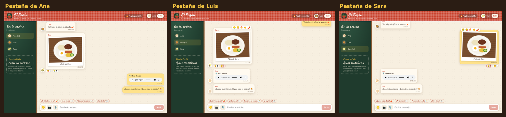
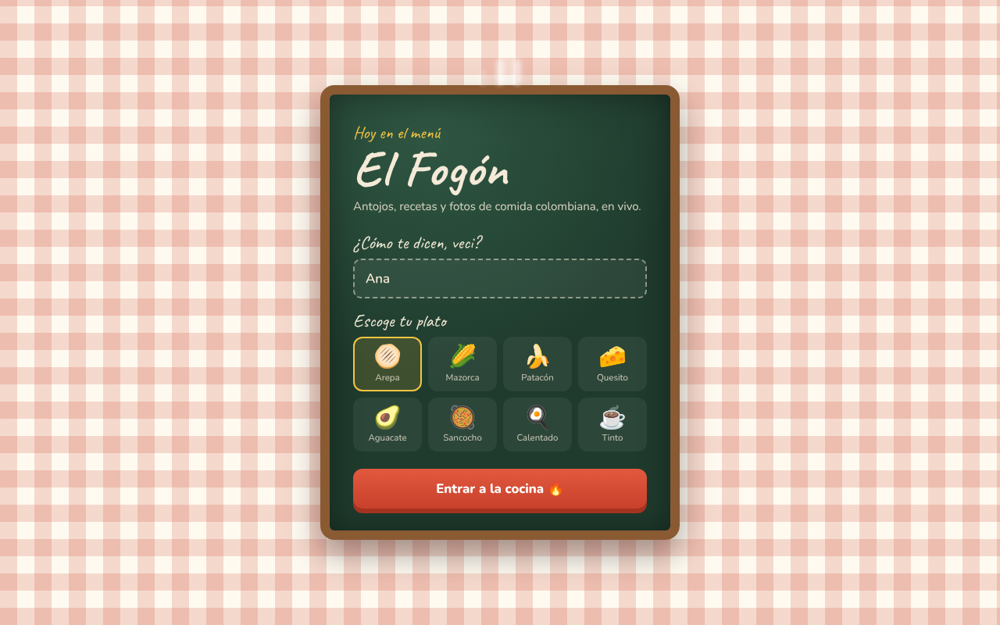
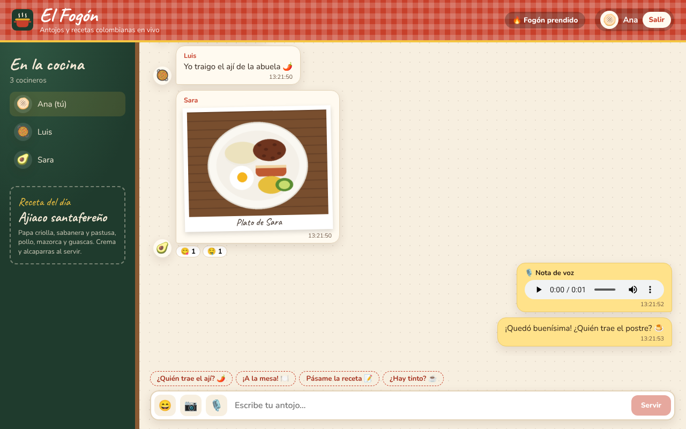
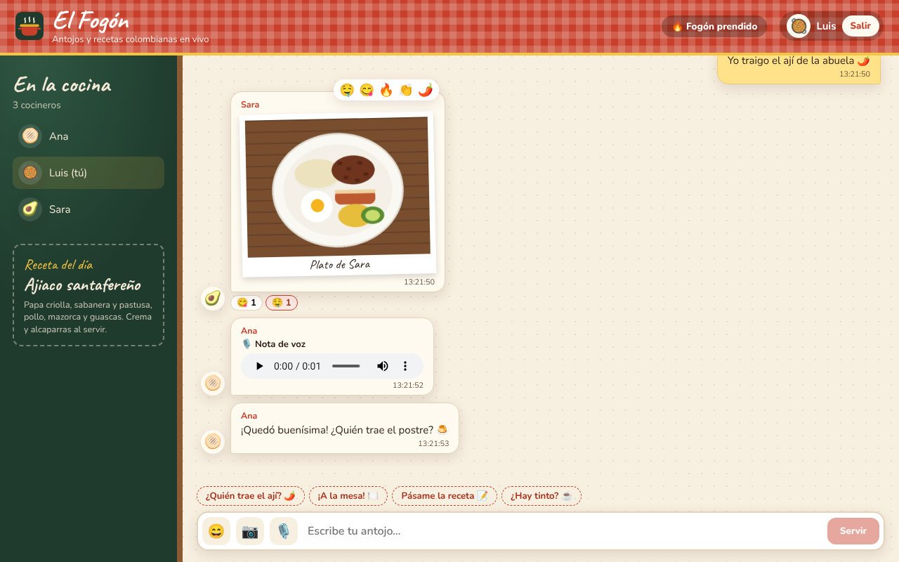
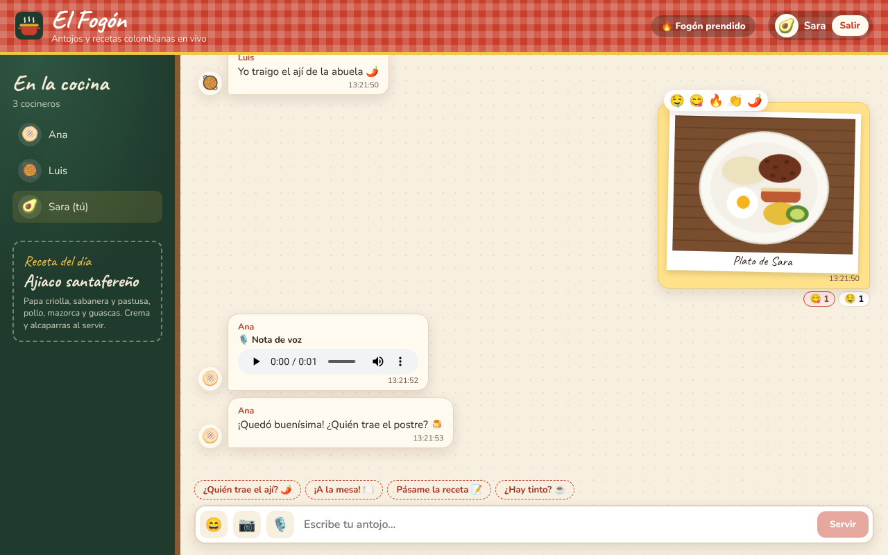
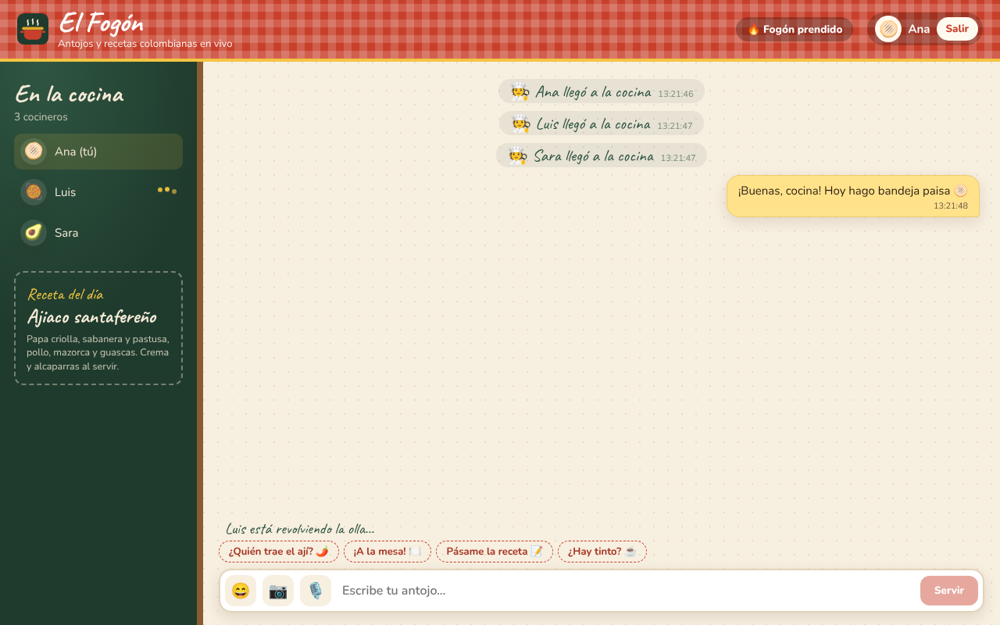
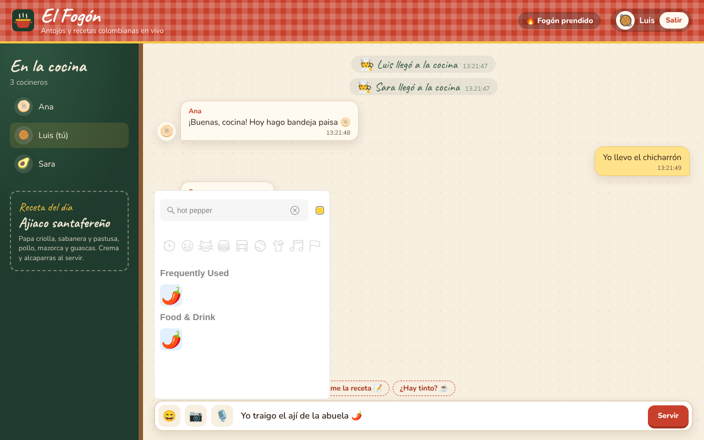
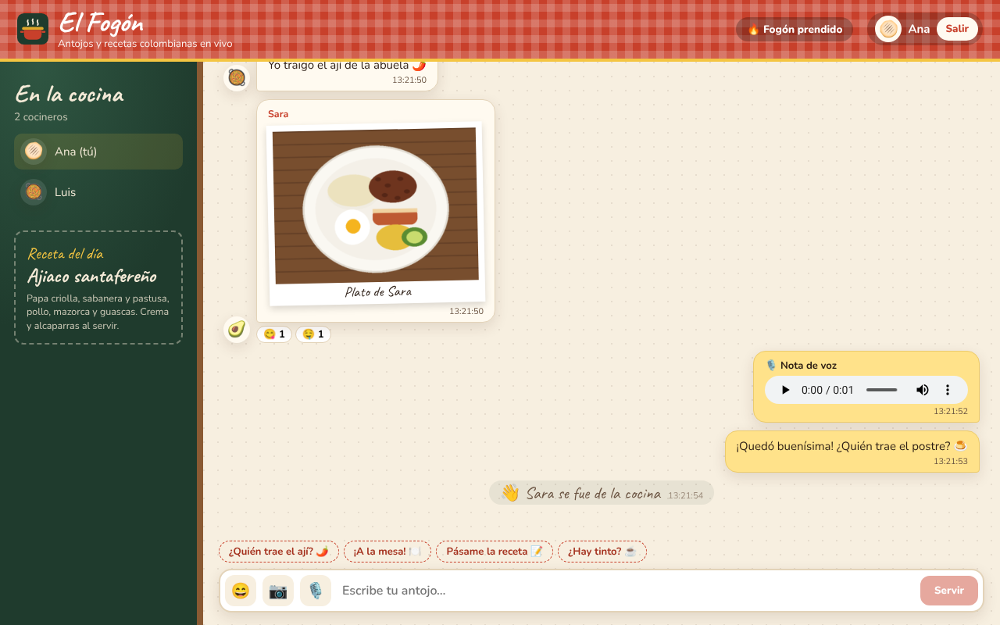
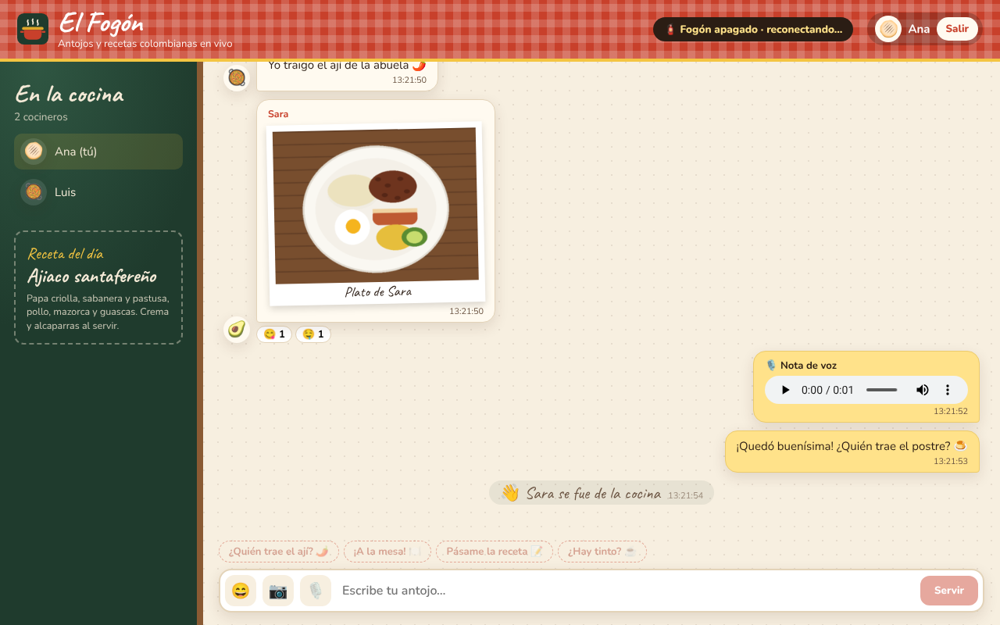
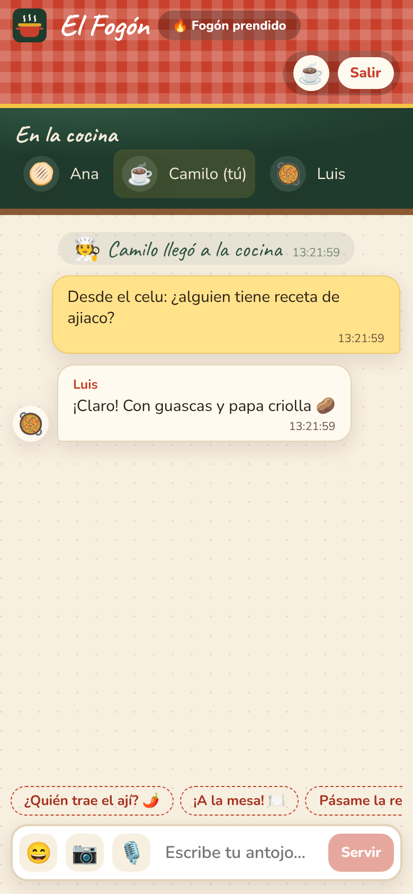

# chat-client · El Fogón

Cliente React del chat en vivo **El Fogón**, un chat de cocina colombiana para compartir antojos,
recetas, fotos de platos y notas de voz en tiempo real. Se conecta por **WebSocket + STOMP** al
[chat-server](https://github.com/JulianMorales2003/chat-server) (Spring Boot).

| | |
|---|---|
| **Estudiante** | Julian Felipe Morales Zambrano |
| **Curso** | DOSW · Semana 15 · Chat en vivo: WebSockets y observabilidad |
| **Servidor (Spring Boot)** | [chat-server](https://github.com/JulianMorales2003/chat-server) |



---

## Cómo se conecta con el servidor

- **WebSocket** en `ws://localhost:8080/ws` usando [`@stomp/stompjs`](https://www.npmjs.com/package/@stomp/stompjs).
  El navegador hace un handshake HTTP y el servidor responde **101 Switching Protocols**. Desde ahí la
  conexión queda abierta y los mensajes van y vienen por ella.
- **HTTP** en `http://localhost:8080/api/archivos` para subir fotos y notas de voz. Por el WebSocket
  solo viaja la URL del archivo.
- Si el servidor se cae, el cliente muestra *"Fogón apagado · reconectando…"* y `reconnectDelay: 3000`
  lo reconecta solo. Al volver, se suscribe otra vez y se vuelve a anunciar en la sala.

Toda la lógica de conexión está en `src/useChat.js`.

### Destinos STOMP

| | Destino | Para qué |
|---|---|---|
| Publica | `/app/chat.unirse` | Entrar a la cocina con nombre y avatar |
| Publica | `/app/chat.enviar` | Enviar `TEXTO`, `IMAGEN`, `AUDIO` o `REACCION` |
| Publica | `/app/chat.escribiendo` | Avisar que está escribiendo (máximo una vez por segundo) |
| Se suscribe | `/topic/sala` | Mensajes, reacciones, entradas y salidas |
| Se suscribe | `/topic/usuarios` | Lista de quién está conectado |
| Se suscribe | `/topic/escribiendo` | Quién está escribiendo |

---

## Cómo correrlo en local

Requisitos: **Node 20 o superior** y el [chat-server](https://github.com/JulianMorales2003/chat-server) corriendo en el puerto 8080.

```bash
npm install
npm run dev
```

Abrir `http://localhost:5173` en **varias pestañas** (o en navegadores distintos), cada una con un nombre diferente.

| Variable (`.env`) | Para qué | Valor por defecto |
|---|---|---|
| `VITE_SERVER_URL` | URL del chat-server | `http://localhost:8080` |

Para ver el handshake: **DevTools → Network → filtro WS**, recargar y entrar al chat. La petición a `/ws`
aparece con estado **101 Switching Protocols** y en la pestaña **Messages** se ven los frames STOMP
(`CONNECT`, `SUBSCRIBE`, `SEND`, `MESSAGE`) que van y vienen por la misma conexión.

---

## Tema: El Fogón · cocina colombiana

Todo el front está pensado alrededor de una cocina colombiana, para que quien entre sin contexto sepa de qué se trata:

- **Login como pizarra de cocina**: marco de madera, letra de tiza (Caveat), humo que sale de la olla y la pregunta *"¿Cómo te dicen, veci?"*.
- **Avatares de comida**: cada persona escoge su plato (arepa, mazorca, patacón, quesito, aguacate, sancocho, calentado o tinto).
- **Mantel de cuadros rojos** en el encabezado y el fondo, y la mesa como papel de recetario.
- **Burbujas**: las propias en amarillo arepa, las de los demás en papel; las fotos se ven como **polaroid** con *"Plato de Ana"*.
- **Mensajes del sistema con voz de cocina**: *"🧑‍🍳 Ana llegó a la cocina"*, *"👋 Sara se fue de la cocina"*, *"Luis está revolviendo la olla…"*.
- **Pizarra lateral "En la cocina"** con los conectados y la *receta del día*.
- Estado de la conexión como *"🔥 Fogón prendido"* o *"🧯 Fogón apagado · reconectando…"*.
- Botones de frases rápidas: *¿Quién trae el ají? 🌶️*, *¡A la mesa! 🍽️*, *Pásame la receta 📝*, *¿Hay tinto? ☕*.



---

## Funciones extra

Todas funcionan en varias pestañas al mismo tiempo.

| Función | Cómo funciona |
|---|---|
| 🖼️ **Fotos de platos** | Botón 📷: sube la imagen por HTTP y envía un mensaje `IMAGEN` con la URL |
| 🎙️ **Notas de voz** | Botón 🎙️: graba con `MediaRecorder`, sube el audio y envía un mensaje `AUDIO` (solo funciona en `localhost` o HTTPS) |
| 😄 **Emojis** | Selector `emoji-picker-react` que se descarga solo la primera vez que se abre |
| ✍️ **"Está escribiendo…"** | Se publica en `/app/chat.escribiendo` y los demás ven *"Luis está revolviendo la olla…"* y unos puntitos al lado de su nombre |
| ❤️ **Reacciones** | Al pasar el mouse por un mensaje aparece 🤤 😋 🔥 👏 🌶️. Cada reacción viaja como mensaje `REACCION` con el id del mensaje; volver a hacer clic la quita, y al pasar el mouse se ve quién reaccionó |
| 👥 **Quién está conectado** | Lista en vivo en la pizarra lateral, actualizada desde `/topic/usuarios` |

### Capturas

Las tres pestañas, cada una desde su punto de vista (Ana, Luis y Sara):







"Está escribiendo…": Ana ve que Luis está escribiendo.



Selector de emojis.



Cuando alguien cierra la pestaña, la sala recibe el aviso y la lista se actualiza.



Si el servidor se cae, el chat lo muestra, deshabilita el envío y se reconecta solo.



Vista en celular.



---

## Observabilidad

La observabilidad (métricas, trazas, logs y el tablero de Grafana) vive en el servidor: ver la sección
**Observabilidad** del README del [chat-server](https://github.com/JulianMorales2003/chat-server).
El tablero queda en `http://localhost:3000`, por eso este cliente usa el puerto **5173**.

---

## Estructura

```
src/
├── useChat.js              # conexión STOMP: suscripciones, publicación, reconexión, subida de archivos
├── config.js               # URL del servidor, avatares, reacciones y frases rápidas
├── App.jsx                 # encabezado, pizarra de conectados y mesa de mensajes
├── components/
│   ├── Login.jsx           # pizarra de entrada con nombre y avatar
│   ├── Mensaje.jsx         # burbuja según el tipo (texto, foto, audio, sistema) + reacciones
│   └── BarraEnvio.jsx      # texto, emojis, foto, nota de voz y frases rápidas
├── index.css               # tema El Fogón
└── main.jsx
```
